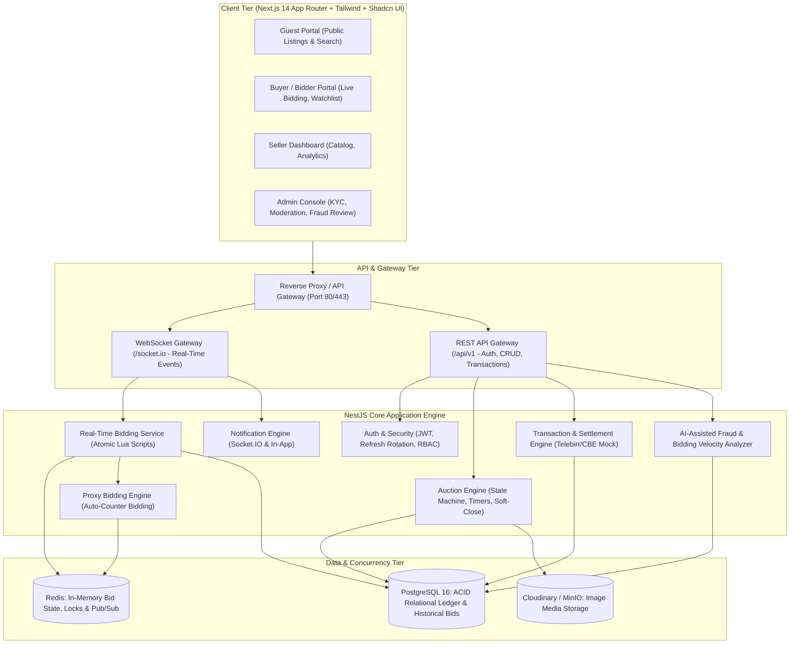
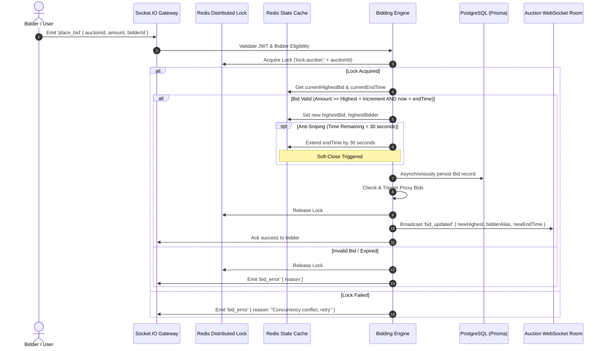

# BIDORA: System Architecture, Database Schema, and Development Roadmap
## Real-Time Online Auction & Bidding Management Platform (Ethiopian & Global Market)

---

## 1. System Architecture Overview

BIDORA is engineered as a decoupled, micro-modular architecture featuring a Next.js (App Router) client and a NestJS real-time backend service, backed by PostgreSQL (via Prisma ORM) and Redis.

---

## 2. Real-Time Bidding & Concurrency Sequence

---

## 3. Database Entity-Relationship Diagram (ERD)

```mermaid
erDiagram
    USER ||--o{ USER_PROFILE : has
    USER ||--o{ AUCTION : creates_as_seller
    USER ||--o{ BID : places
    USER ||--o{ PROXY_BID : configures
    USER ||--o{ WATCHLIST : watches
    USER ||--o{ NOTIFICATION : receives
    USER ||--o{ TRANSACTION : buyer_or_seller
    USER ||--o{ VERIFICATION_REQUEST : submits
    USER ||--o{ AUDIT_LOG : triggers
    
    CATEGORY ||--o{ AUCTION : categorizes
    AUCTION ||--o{ AUCTION_IMAGE : contains
    AUCTION ||--o{ BID : receives_bids
    AUCTION ||--o{ PROXY_BID : receives_proxy
    AUCTION ||--o{ WATCHLIST : watched_by
    AUCTION ||--o| TRANSACTION : settles_into
    AUCTION ||--o{ DISPUTE : generates

    USER {
        uuid id PK
        string email UK
        string passwordHash
        enum role "GUEST | BUYER | SELLER | ADMIN"
        enum status "ACTIVE | SUSPENDED | PENDING_VERIFICATION"
        boolean emailVerified
        string refreshTokenHash
        timestamp createdAt
        timestamp updatedAt
    }

    USER_PROFILE {
        uuid id PK
        uuid userId FK, UK
        string fullName
        string phoneNumber
        string nationalIdNumber
        string city
        string address
        string avatarUrl
        string nationalIdUrl
        boolean isKycVerified
        decimal escrowBalanceETB
    }

    CATEGORY {
        uuid id PK
        string name UK
        string slug UK
        string description
        string iconName
    }

    AUCTION {
        uuid id PK
        uuid sellerId FK
        uuid categoryId FK
        string title
        text description
        string condition "BRAND_NEW | LIKE_NEW | REFURBISHED | USED | FOR_PARTS"
        string locationCity
        decimal startingPrice
        decimal currentHighestBid
        decimal reservePrice
        decimal bidIncrement
        enum status "DRAFT | PENDING_REVIEW | ACTIVE | EXTENDED | ENDED | CANCELLED"
        timestamp startTime
        timestamp endTime
        timestamp originalEndTime
        integer antiSnipingExtensions
        uuid winningBidderId FK
        timestamp createdAt
        timestamp updatedAt
    }

    AUCTION_IMAGE {
        uuid id PK
        uuid auctionId FK
        string url
        integer displayOrder
        boolean isCover
    }

    BID {
        uuid id PK
        uuid auctionId FK
        uuid bidderId FK
        decimal amount
        string bidderAlias
        boolean isProxyBid
        string ipAddress
        timestamp placedAt
    }

    PROXY_BID {
        uuid id PK
        uuid auctionId FK
        uuid bidderId FK
        decimal maxAmount
        boolean isActive
        timestamp createdAt
    }

    WATCHLIST {
        uuid id PK
        uuid userId FK
        uuid auctionId FK
        timestamp addedAt
    }

    NOTIFICATION {
        uuid id PK
        uuid userId FK
        string title
        text message
        enum type "OUTBID | BID_ACCEPTED | AUCTION_ENDING | AUCTION_WON | LISTING_APPROVED | PAYMENT_DUE"
        boolean isRead
        string linkUrl
        timestamp createdAt
    }

    TRANSACTION {
        uuid id PK
        uuid auctionId FK, UK
        uuid buyerId FK
        uuid sellerId FK
        decimal finalAmount
        enum paymentStatus "PENDING | IN_ESCROW | RELEASED_TO_SELLER | REFUNDED"
        enum deliveryStatus "PENDING | DISPATCHED | DELIVERED | INSPECTED_AND_ACCEPTED"
        string paymentProvider "TELEBIRR | CBE_BIRR | BANK_TRANSFER | CASH_ON_PICKUP"
        string paymentReference
        timestamp paidAt
        timestamp createdAt
    }

    VERIFICATION_REQUEST {
        uuid id PK
        uuid userId FK
        string nationalIdType
        string documentFrontUrl
        string documentBackUrl
        enum status "PENDING | APPROVED | REJECTED"
        string reviewerNotes
        timestamp reviewedAt
    }

    AUDIT_LOG {
        uuid id PK
        uuid userId FK
        string action
        string entityType
        string entityId
        jsonb metadata
        string ipAddress
        timestamp timestamp
    }
```

---

## 4. Development Milestones & Phased Execution Plan

- **Phase 1: Foundation & Workspace Structure**
  - Establish modular monorepo directory layout: `backend/` (NestJS) and `frontend/` (Next.js).
  - Setup unified TypeScript configurations, Docker Compose, and environment configuration templates.
- **Phase 2: Database & Prisma ORM Schema**
  - Implement complete Prisma schema covering Users, Profiles, Roles, Categories, Auctions, Bids, ProxyBids, Transactions, Notifications, and AuditLogs.
  - Implement database seeding with realistic Ethiopian test data (ETB currency, Addis Ababa/Hawassa/Bahir Dar locations, realistic auction items, test credentials for Admin, Seller, and Buyer).
- **Phase 3: Backend Core & Real-Time Engine (NestJS)**
  - Auth Module (Argon2 password hashing, JWT Access + Refresh token rotation, RBAC guards).
  - Auctions Module (Full CRUD, state transitions, category filters, server-controlled end times).
  - Bidding Module with Socket.IO Gateway & Redis concurrency locking (atomic updates, anti-sniping soft-close rule, private proxy counter-bidding algorithm).
  - Transactions & Simulated Payment Gateway (Telebirr & CBE Birr mock workflows with escrow states).
  - AI-assisted Fraud Detection (Bid velocity analysis, repetitive bidder pairs/shill detection, explainable heuristic scoring).
- **Phase 4: Frontend Application (Next.js 14 App Router)**
  - Theme & Design System (Deep navy `#0A192F` / `#0F172A`, slate backgrounds, subtle blue accents, Shadcn UI, Lucide icons).
  - Public Marketplace (Hero section, search, multi-category filters, condition filters, live auction cards with live ticker).
  - Real-Time Auction Details View (Image gallery, real-time bid updates without page reload, dynamic countdown timer, proxy bid configuration, bid history list, seller trust badge).
  - Dedicated Dashboards:
    - Buyer Dashboard: Active bids, watchlist, won auctions, transaction statuses.
    - Seller Dashboard: Listing management, bid performance, revenue analytics.
    - Admin Console: User moderation, KYC verification, auction approval, fraud alerts, platform metrics.
- **Phase 5: Automated Testing & Verification**
  - Unit tests for the bidding engine, proxy counter-bidder, and anti-sniping timer.
  - Concurrency test simulating multiple simultaneous bids on the exact same auction.
  - Verification of responsive behavior and end-to-end integration.
