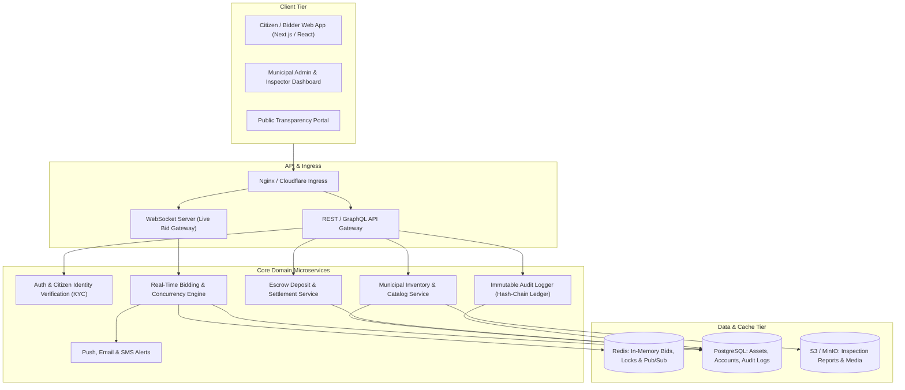
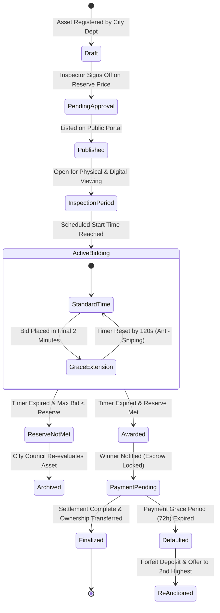
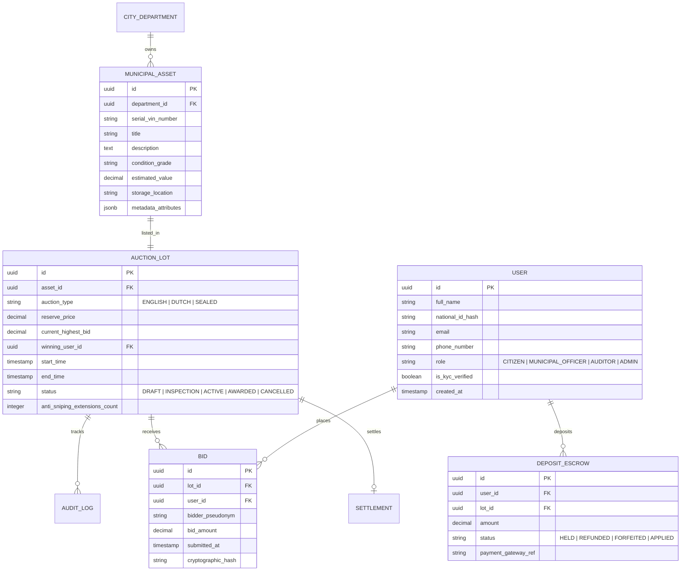

# CivicBid: Municipal Smart Auction & Public Asset Disposal Platform
## Final Year Project (FYP) Specification & System Documentation

---

## 1. Executive Summary & Problem Context

### 1.1 City Context: The Municipal Auction Challenge
Municipalities frequently auction off public assets, including:
- Impounded and abandoned vehicles.
- Confiscated or seized goods.
- Surplus municipal fleet equipment, electronics, and office furniture.
- Public real estate leases and tax-delinquent properties.
- Municipal concession rights (e.g., city billboard spots, public park kiosks).

**Existing City Bottlenecks:**
1. **Collusion & Cartels:** Physical in-person auctions often suffer from local cartels ("bidding rings") that intimidate regular citizens or agree off-the-record to keep prices artificially low.
2. **Limited Reach & Suppressed Revenue:** Only local professional dealers attend; ordinary citizens miss out, which depresses recovery value for the city treasury.
3. **Lack of Transparency & Auditability:** Paper records and manual cash deposits leave room for disputes, bribery, and audit flags.
4. **Administrative Overhead:** High operational burden on municipal staff to verify cashier's checks, track physical bidding paddles, and issue manual refund receipts.

### 1.2 The Proposed Solution
**CivicBid** is a secure, real-time, tamper-evident civic auction web and mobile platform designed specifically for municipal authorities. It:
- Democratizes access for everyday citizens through digital access and transparent listings.
- Eliminates bidder collusion through pseudo-anonymous real-time bidding.
- Enforces algorithmic fairness via anti-sniping soft-close rules.
- Automates guarantee deposits with an escrow model to deter bad-faith bidders.
- Generates an immutable, verifiable audit trail for city ombudsmen and the public.

---

## 2. System Architecture & High-Level Design



---

## 3. Auction State Machine & Lifecycle

Municipal auctions must follow strict legal inspection schedules and anti-sniping rules:



---

## 4. Key Functional Modules (SRS)

### 4.1 Citizen & Bidder Management
- **Citizen Digital Verification (KYC):** Integration with national/city identity provider (or national ID/passport upload + verification).
- **Pseudonymous Bidding:** Bidders receive a cryptographically generated alias per auction (e.g., `Bidder #4928`) to prevent in-room collusion, retaliation, or intimidation.
- **Deposit Escrow System:** Bidders place a refundable security deposit (e.g., \$100 or 10% of estimated asset value) to prevent frivolous or bad-faith bidding.

### 4.2 Real-Time Bidding Engine
- **Auction Formats Supported:**
  1. *English Ascending Auction (Default):* Standard open-cry auction with soft-close anti-sniping.
  2. *Dutch Descending Auction:* Ideal for bulk municipal scrap/equipment liquidation.
  3. *Sealed-Bid First-Price / Second-Price (Vickrey):* For municipal property leases and public procurement tenders.
- **Concurrency & Race Condition Control:**
  - Microsecond bid resolution handled via Redis In-Memory Lua scripts with distributed locks to avoid duplicate winning bids at the exact same millisecond.
- **Anti-Sniping (Soft-Close Rule):** Any bid received within the final 2 minutes extends the countdown by an additional 2 minutes.

### 4.3 Municipal Management & Inventory Catalog
- **Asset Intake & Chain of Custody:** Tracks origin (e.g., Police Impound Lot, Public Works Dept, City Council Surplus).
- **Physical Inspection Booking:** Citizens can schedule guided inspection visits at city warehouses.
- **Reserve Price & Dynamic Minimum Increment Rules:** Automatic increment tiers (e.g., +\$10 for assets < \$500; +\$100 for assets > \$5,000).

### 4.4 Financial Settlement & Legal Handover
- **Automated Settlement:** Deducts winning amount; automatically releases held deposit holds for non-winning bidders within 24 hours.
- **Digital Certificate of Award:** Generates an official QR-coded, digitally signed PDF bill of sale for DMV/title transfer or gate pickup at the city depot.

### 4.5 Civic Anti-Corruption & Open Data Portal
- **Tamper-Evident Bid History:** Each bid generates an immutable hash chain:
  `Hash_n = SHA256(Bid_n + Timestamp + Hash_{n-1})`
- **Public Open Data API:** City journalists, watchdogs, and municipal auditors can download anonymized bidding history in JSON/CSV format.

---

## 5. Database Schema (Entity-Relationship)



---

## 6. Implementation Blueprint & Recommended Tech Stack

| Layer | Recommended Technology | Justification for Final Year Project |
| :--- | :--- | :--- |
| **Frontend** | Next.js 14 / React + Tailwind CSS + Shadcn/ui | Fast, accessible, mobile-responsive UI with SEO for public municipal notices. |
| **Backend API** | Node.js (NestJS) or Python (FastAPI) | High throughput, asynchronous I/O, clean architecture, automatic OpenAPI/Swagger docs. |
| **Real-Time Engine** | WebSockets (Socket.io or WS) + Redis Pub/Sub | Sub-100ms real-time broadcast of incoming bids to all connected clients. |
| **State & Locks** | Redis (Lua scripts) | In-memory distributed locking and atomic bid updates with zero race conditions. |
| **Primary Database** | PostgreSQL 16 | ACID-compliant transactional consistency for monetary transactions and asset state. |
| **Audit Verification** | SHA-256 Hash Chain Ledger | High academic value for FYP: cryptographic proof that city officials cannot alter bids. |
| **DevOps & Testing** | Docker Compose, k6 (Load Testing), GitHub Actions | Easy deployment for university supervisors; automated load benchmarks. |

---

## 7. Crucial FYP Technical Algorithms

### 7.1 Atomic Bid Validation & Anti-Sniping (Redis Lua Script Concept)

To prevent race conditions where two citizens bid at the exact same millisecond:

```
Algorithm: ProcessBid(lot_id, user_id, bid_amount)
1. Acquire Redis distributed lock for `lot:{lot_id}` (TTL: 500ms)
2. Read current_highest_bid and current_end_time from Redis
3. Validate:
     IF now() > current_end_time THEN REJECT ("Auction Closed")
     IF bid_amount < (current_highest_bid + minimum_increment) THEN REJECT ("Bid Too Low")
     IF NOT HasVerifiedDeposit(user_id, lot_id) THEN REJECT ("Missing Deposit")
4. Update:
     SET current_highest_bid = bid_amount
     SET highest_bidder = user_id
5. Anti-Sniping Check:
     IF (current_end_time - now()) < 120 seconds THEN
         current_end_time = current_end_time + 120 seconds
         SET anti_sniping_extended = true
6. Append to In-Memory Audit Hash Log:
     new_hash = SHA256(lot_id + user_id + bid_amount + now() + previous_hash)
7. Release Redis distributed lock
8. Async dispatch: Broadcast `BID_ACCEPTED` via WebSockets to all room subscribers
9. Async dispatch: Persist bid and updated lot status to PostgreSQL
```

---

## 8. Final Year Project Academic Report Structure

For your university FYP thesis defense, structure your chapters as follows:

- **Chapter 1: Introduction**
  - Background of municipal public asset management.
  - Problem Statement: Traditional auction inefficiencies, corruption, and bid cartels.
  - Project Aims & Measurable Objectives.
  - Scope and Limitations.
- **Chapter 2: Literature Review & Comparative Analysis**
  - Review of auction theory (English, Vickrey, Dutch).
  - Review of commercial solutions (e.g., GovDeals, Municibid, eBay) vs. public transparency standards.
  - Study of real-time state synchronization algorithms (WebSockets vs. Long-polling).
- **Chapter 3: System Requirements & Methodology**
  - Software Development Life Cycle (Agile Scrum).
  - Functional & Non-Functional Requirements (latency, security, concurrency).
  - Use Case diagrams and User Personas (Citizen, Municipal Official, Finance Auditor).
- **Chapter 4: System Architecture & Database Design**
  - High-level architecture, deployment diagram, component interactions.
  - Data modeling (ERD), normalization (3NF), data dictionary.
  - Concurrency management and anti-sniping algorithm design.
- **Chapter 5: Implementation Details**
  - Core bidding WebSocket engine.
  - Security implementation (JWT, RBAC, KYC verification, anti-tamper ledger).
  - Payment gateway escrow simulation/integration.
- **Chapter 6: Testing, Evaluation & Load Testing**
  - Unit testing & integration testing.
  - Load and stress testing (Simulating 1,000+ concurrent bidders using k6 or Apache JMeter to prove sub-100ms latency).
  - Usability testing and civic accessibility evaluation (WCAG 2.1 compliance).
- **Chapter 7: Discussion, City Impact & Future Work**
  - Projected municipal revenue increase and citizen engagement metrics.
  - Future extensions: AI-based vehicle condition assessment from photos, integration with municipal blockchain.
- **References & Appendices**
